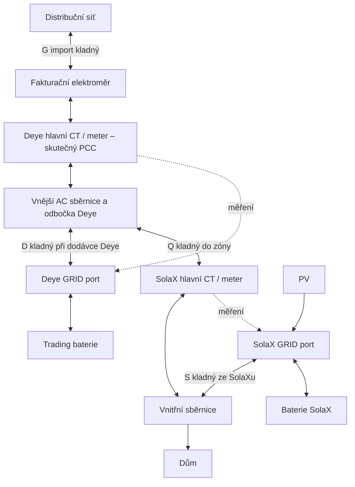

# ENERGY V3 — jednoduché HA řízení s asymetrickým měřením

Stav: návrh k revizi, 2026-11-04. Žádný runtime ani fyzický příkaz se tímto PR nenasazuje.
Audit main: tree 98e76aeab0fc692d70f532b36613ee8d2a82afda.
Zařízení: SolaX X3-HYBRID-12.0-D G4.2 a Deye SUN-12K-SG05LP3-EU (uživatelem dříve upřesněno SM2).
Fyzické přepojení měření dosud neproběhlo. Návrh nesmí být aktivován pod současnou topologií.

## 1. Rozhodnutí a důkazní hranice

Použít samostatný optimalizátor → úzké požadavkové rozhraní → HA skripty/automatizace → existující integrace.
SolaX řídí svou zónu autonomně. Deye zachytává zbytkové přebytky a provádí obchodní operace.
Nepřenášet LP planner, allocator ani obecný transakční executor do nového runtime.

**Uživatelem prakticky potvrzeno:** Deye nabíjí z externích AC přebytků přes GRID; existuje více funkčních způsobů zákazu nabíjení/vybíjení. Audit to respektuje. Není však znám přesný ověřený postup, firmware, latence a restart/timeout chování každého způsobu.

**Přímo přečteno z produkce přes read-only SSH:** HA Core 2026.10.4; filtrovaný registr entit; /config/packages/energy_v3.yaml; definice Remote Control v custom_components/solarman/inverter_definitions/deye_p3.yaml; relevantní části custom_components/solax_modbus/plugin_solax.py a services.yaml Solarman. Registrovaná entita není důkaz dostupného aktuálního HW readbacku.

**Neověřeno v tomto auditu:** živé stavy, service registry za běhu, firmware MAIN/HMI, naměřené reakční časy, zápisová persistence, watchdog fallback, fyzická polarita PCC a aktuální stav všech konfliktních writerů. Přímý GET HA API přes existující prostředí SSH add-onu vracel 401. HA MCP home_assistant_chalupa uvedený v AGENTS.md není mezi dostupnými nástroji této relace. Nebyly hledány jiné credentials ani volány ovládací služby. Soubor core.restore_state obsahoval z filtrovaných remote entit jen historický stav trigger buttonu; nelze jej vydávat za živou telemetrii.

Produkce již obsahuje **preview-only ENERGY V3 REVIZE 2 z 2026-10-10**, s script.energy_v3_request a eventem energy_v3_request. Nové rozhraní proto používá jiná jména; starý package se při budoucí migraci archivuje a nesmí vedle nového provádět řízení.

## 2. Fyzická topologie a bilance

Schéma je funkční model pro návrh, ne montážní dokumentace. EPS/LOAD/ATS a jištění musí být později doplněny podle skutečnosti.



Bez ztrát: Q = H − S; G = Q − D. Deye není členem lokální měřené bilance SolaXu.
Nabíjení/prodej Deye tedy nemá být kompenzováno SolaXem přes jeho hlavní CT.
Deye naopak vidí zbytkovou spotřebu i export zóny. Původ exportu (PV versus baterie SolaX) z PCC nepozná.

SolaX musí dovolit přebytek ven ze své zóny. Lokální export control 0 W může omezit PV dříve, než Deye uvidí přebytek.
Při plném/odpojeném Deye přebytek pokračuje do sítě. Deye exportní limit neumí automaticky přiškrtit SolaX.
Výslovná podpora vyjmuté trading větve výrobcem SolaX není doložena; přijatelnost hranice lokální regulace zůstává podmínkou projektového ověření.

## 3. Jednotné veličiny a nové PCC

V rozhraní V3: výkon baterie **kladný vybíjení, záporný nabíjení**; PCC **kladný export**. Vše ve W.
Převody existují jen na hranici integrací. Staré V2 používá baterie opačně: kladné nabíjení.

Kritický rozpor: README/SAFETY_INVARIANTS V2 uvádí sensor.solax_measured_power kladně export; aktuální plugin SolaX i produkční V3 preview uvádějí kladně import. Nevolit znaménko podle názvu ani staré dokumentace. Vyžadovat korelaci s nezávislým PCC měřením při známém importu a exportu.

Po přepojení:
- sensor.solax_measured_power = **zóna**, nikdy autorita celého PCC.
- sensor.deye_external_power = kandidát PCC z externích CT; ověřit vztah k součtu sensor.deye_external_ct1_power/ct2_power/ct3_power.
- sensor.deye_grid_power může být vlastní GRID port Deye; bez korelace jej nepoužít jako PCC.
- Nový navrhovaný sensor.energy_v3_pcc_export_w bude normalizovaný alias ověřeného zdroje. Nyní neexistuje jako potvrzená entita.
- Výpadek Deye nesmí znemožnit ochranu PCC při aktivním prodeji SolaXu. Pokud externí CT přestane publikovat, zastavit obchod; pro autonomní PV zůstává nutná samostatná ochrana.
- G + D = Q je diagnostická kontrola při sladěných časech, ne náhrada skutečného PCC.

## 4. Konkrétní HA rozhraní z auditu

Všechny níže uvedené Remote/VPP entity byly nalezeny ve filtrovaném registru s disabled_by=null.
Volby a registry jsou z nainstalovaného zdrojového kódu; aktuální živé hodnoty nebyly dostupné.

| Úloha | Entity / služby | Zjištění |
|---|---|---|
| SolaX režim | select.solax_charger_use_mode | Self Use Mode zná produkční preview; přesné live options ještě přečíst |
| SolaX skutečný VPP režim | sensor.solax_modbus_power_control | HW readback, nepovažovat optimistický select za potvrzení |
| SolaX přímé VPP | select.solax_modbus_power_control_direct; select.solax_remote_control_target_set_type_direct | Plugin sestavuje úplný FC16 blok, mode 0 vypíná VPP; přesné labels je nutné dodat před implementací |
| SolaX mode 1 parametry | number.solax_remotecontrol_active_power_direct; number.solax_remotecontrol_reactive_power_direct; number.solax_remotecontrol_duration_direct; number.solax_remotecontrol_timeout_direct | Registry bloku 0x7C..0x88; neplést mode 1 AC výkon s bateriovým setpointem |
| SolaX další VPP parametry | number.solax_remotecontrol_charge_discharge_power_direct; number.solax_remotecontrol_push_mode_power_direct | Mode 2/3 respektive 4; přesná provozní volba zůstává neověřená |
| SolaX původní autorepeat | select.solax_remotecontrol_power_control; number.solax_remotecontrol_active_power; number.solax_remotecontrol_duration; number.solax_remotecontrol_autorepeat_duration; button.solax_remotecontrol_trigger | Existuje lokální opakovací smyčka integrace; nemíchat s přímým VPP |
| Deye remote enable | select.deye_remote_mode | 1100; Disabled / Remote mode 1 / Remote mode 2 / Remote mode 3; který mode použít musí doložit test |
| Deye typ cíle | select.deye_remote_power_control_mode | 1104; AC-side control / Battery-side control; Grid-side zde není vystaven |
| Deye strategie | select.deye_remote_battery_side_control_strategy | 1105; jen Power (2). SOC-aware strategie 3–5 nejsou vystavené |
| Deye výkon | number.deye_remote_constant_power_setpoint | 1109 signed; procenta jmenovitého výkonu, krok 0,1 %, rozsah entity ±120 % |
| Deye SOC | number.deye_remote_constant_soc_setpoint | 1110; krok 0,1 %. V Power (2) nelze předpokládat vynucení tohoto SOC |
| Deye watchdog | number.deye_remote_watchdog; sensor.deye_remote_watchdog_status | 1101; 10–18000 s, sentinel 65535 = Disabled. Remote skupina čtena po 30 s |
| Nebezpečná volba | button.deye_disable_remote_watchdog | Zapisuje 65535; V3 ji nepoužije |
| Nativní Deye | select.deye_work_mode; select.deye_time_of_use; select.deye_ac_coupling; switch.deye_export_surplus | Registrováno, přesné volby číst z live atributů před implementací |
| Limity proudu | number.deye_battery_max_charging_current; number.deye_battery_max_discharging_current | Registrováno; přijatelnost nuly a efekt na firmware ověřit |
| Limity sítě | number.deye_grid_max_export_power; number.deye_grid_max_import_power | Nejsou náhradou globálního PCC limiteru |
| SolaX SOC limity | number.solax_selfuse_discharge_min_soc; number.solax_battery_charge_upper_soc | Respektovat fyzická/BMS omezení |
| Fyzická telemetrie | sensor.solax_battery_capacity; sensor.solax_battery_power_charge; sensor.solax_inverter_power; sensor.solax_pv_power_total; sensor.deye_battery; sensor.deye_battery_power; sensor.battery_power_otoceny; sensor.deye_power | Historická repo mapa; použitelnost live znovu ověřit |
| Health | binary_sensor.deye_connection; binary_sensor.deye_battery_fault; binary_sensor.deye_battery_alarm; sensor.deye_device_fault; sensor.solax_run_mode | Repo V3 nemá ověřený SolaX fault readback |

Deye přepočet pro 12 kW: procenta = P_W / 120; raw1109 = procenta × 10.
Například +2400 W = +20 % = raw +200. Kvantovat k nule po 12 W; rozsah ±120 % není povolení provozovat ±14,4 kW.
SolaX původní preview uvádí kladné nabíjení/záporné vybíjení a 100W krok; je to tvrzení konfigurace, nikoli fyzicky ověřená univerzální polarita všech VPP módů.

Budoucí entity volat standardně přes number.set_value, select.select_option, button.press, switch.turn_on/off. Specifikace těchto standardních akcí je návrh; live service registry nebyl načten.
Lokální Solarman services.yaml potvrzuje read_holding_registers/read_input_registers a write_single_register/write_multiple_registers s device/address/value(s).
Přímé zápisové služby nepatří do API optimalizátoru. V auditu nebyla volána žádná.
HAEO entity sensor.battery_* a number.battery_* jsou model optimalizátoru, nikoli potvrzení fyzického stavu.

## 5. Blokování Deye — volba jedné otestované cesty

| Způsob | Výhoda | Riziko / watchdog / persistence | Návrh |
|---|---|---|---|
| Battery-side Remote Power = 0 | Jeden průběžný setpoint pro HOLD i obchod, bez přepisu TOU | Nula nemusí v každém mode blokovat všechny cesty; timeout může obnovit nativní zachytávání; SOC strategie Power nemá doloženou ochranu | Preferovaný kandidát po ověření nuly, obou směrů a fallbacku |
| Maximální charge/discharge proud = 0 | Nezávislé směrové zákazy | Nula/range neověřené; pravděpodobně konfigurační cesta, persistence/EEPROM a priorita BMS neověřené; restart může blok držet | Jednorázový interlock na přechodu, pokud odpovídá uživatelovu ověřenému postupu |
| AC coupling Disabled + TOU/Export/Grid Charge vypnout | Využije existující nativní nastavení | Samotné AC coupling off nemusí blokovat vybíjení; Grid Charge off nemusí blokovat surplus charging; více zápisů, částečný přechod | Pouze jako celý potvrzený profil, ne jednotlivý „magický“ switch |
| Vypnutí Deye | Hrubé oddělení | Startup latency, ztráta telemetrie PCC, dostupnost skutečného OFF readbacku; opotřebení relé/cykly | Jen servisní či ověřený fallback, ne regulační smyčka |
| BMS charge/discharge enable | Tvrdší směrový zákaz | Zásah do ochranné vrstvy, priorit a obnovy BMS, přesná rozhraní neauditována | Nevolit jako běžné API V3 |

Žádná naměřená latence ani počet garantovaných EEPROM cyklů nebyly získány. Nelze tvrdit „Remote je určitě RAM“.
Požadovat potvrzení výrobce nebo test persistence/timeoutu; samotný restart nepotvrdí typ paměti.
Konfigurační limity měnit pouze při přechodu a jen pokud se hodnota liší. TOU/current settings nepřepisovat každých několik sekund.
Heartbeat posílat jen do prokázané provozní/volatile cesty. Pokud její persistence není známá, omezuje to aktivaci.
Výchozí kandidát heartbeat 10 s a timeout 30–60 s je pouze návrh k měření; při readbacku 30 s nelze slibovat 1s potvrzení.
Nikdy nevypínat watchdog pro pohodlnější řízení.

Před aktivací zaznamenat přesný uživatelem ověřený recept do tabulky: vstupní režim, zapisované entity/volby, readback, skutečné proudy, latence, reboot a timeout. Vybrat jednu cestu, ostatní ponechat servisní.

## 6. Režimy a povolené toky

| Režim | SolaX | Deye | Povolené toky a podmínky |
|---|---|---|---|
| SELF_USE | Autonomní vlastní zóna | HOLD obou směrů | PV→dům/baterie SolaX; zbytkový import/export; Deye uchovává trading energii |
| PV_AUTO | Autonomní | Nativní GRID surplus charge, vybíjení zakázáno | Jen skutečný přebytek→Deye; nesmí běžet úmyslný prodej/nákup SolaXu |
| DEYE_SELL | Autonomní | Bounded remote discharge | Deye→PCC/dům, žádné jeho nabíjení; celkový PCC guard |
| SOLAX_SELL | Ověřený VPP discharge | Potvrzený HOLD obou směrů | SolaX→dům/PCC; Deye nesmí export odsát |
| SOLAX_AC_CHARGE | Ověřený VPP charge | Potvrzený HOLD obou směrů | Síť/PV→SolaX; Deye nesmí odběr krýt |
| DEYE_AC_CHARGE | Autonomní | Ověřený bounded remote charge | Volitelné pro obchod, default zakázané; oddělený importní limit |
| SAFE | Ukončení VPP, ověřený autonomní profil | Ověřený neobchodní profil | Žádný nucený obchod; přesný fallback musí být testován |

SELF_USE a PV_AUTO jsou záměrně různé: normální profil může být po validaci PV_AUTO, ale při chybě interlocku se automaticky nepovolí zachytávání.
Autonomní SolaX může i během DEYE_SELL ukládat vlastní PV; opačná znaménka baterií sama o sobě nedokazují přelévání.
Detekce má využít Q, PV, oba bateriové výkony a povolený režim; alarm při nevysvětlitelném transferu musí zastavit nucené operace.
Současný nucený obchod obou baterií V3 první verze nepovoluje.

## 7. Minimální HA implementace: 4 skripty + 2 automatizace

Jeden package, žádný nový Python controller. Jména jsou návrh, nyní je nevytvářet.

1. **script.energy_v3_submit** — veřejný vstup; atomicky validuje celý payload, nastaví požadavek a zavolá reconcile. Žádné samostatně přepisované mode/power helpery jako transakční API.
2. **script.energy_v3_reconcile** — jediný vlastník přechodů, mode single s frontou v požadavkovém stavu; ne restart, který by přerušil interlock. Vyhodnotí expiry/health/SOC/PCC a připraví oba profily; blokuje nové přechody během potvrzování. Žádný dlouhý 15min delay.
3. **script.energy_v3_apply_solax** — soukromý adapter, ověřená cesta direct VPP nebo původní autorepeat, nikdy obě. Potvrzení skutečného režimu a výkonu; odlišit AC/battery target.
4. **script.energy_v3_apply_deye** — soukromý adapter, HOLD/PV_AUTO/remote power, watchdog a potvrzení. Volají jej pouze reconcile a jeho safety větev.

Automatizace:
- **automation.energy_v3_supervisor**: HA start, změna požadavku, relevantní health/PCC, periodický tick. Expiry, deadband, SOC, čerstvost, export guard, heartbeat jen platného příkazu. Tik nesmí udržovat expirovaný cíl.
- **automation.energy_v3_safety**: nezávisle sleduje vypršení heartbeat/příkazu, writer conflict, export a neočekávané toky. Nastaví latched fault a zneplatní požadavek. Při běžícím reconcile vyžaduje přednostní abort před dalším zápisem; nesmí souběžně psát adapterům. Bounded wait, poté alarm; ne donekonečna čekající queued STOP.

Pomocníci: enabled (initial off), topology_verified (initial false), fault latch, accepted command (jeden JSON), applied mode, reason, last confirmed transition a heartbeat. Delší payload držet v atributech vhodného stavového objektu/eventu; input_text limit 255 znaků nepřeplnit. Konkrétní persistence požadavku je implementační volba, ale start HA jej vždy zneplatní.

Přechod vždy break-before-make:
- Ukončit předchozí nucenou operaci; do potvrzení nezapínat novou.
- Před SOLAX_SELL/AC_CHARGE potvrdit Deye HOLD fyzickým readbackem a měřením (tolerance a počet vzorků z měření latence).
- Teprve potom poslat krátkodobý VPP příkaz SolaXu.
- Při ukončení nejdřív zastavit/ověřit SolaX VPP; až pak uvolnit Deye PV_AUTO.
- Chyba druhého kroku znamená rollback již provedené části a latched fault. Bez potvrzení nelze označit SAFE jako dosažený.

## 8. API pro libovolný optimalizátor

Návrh jediného action script.energy_v3_submit:

```yaml
mode: SOLAX_SELL
power_w: 2000
issued_at: "2026-11-04T14:00:00+01:00"
valid_until: "2026-11-04T14:01:00+01:00"
command_id: optimizer-a-123
```

power_w je nezáporná velikost; směr a zařízení jednoznačně určuje mode. Pro SELF_USE/PV_AUTO/SAFE musí být 0.
Jeden vlastník optimalizátoru, max TTL návrhově 120 s, budoucí issued_at nepřijmout mimo toleranci hodin, valid_until > issued_at a > now.
Neplatné/NaN/boolean/mimo rozsah → odmítnout; replay staršího příkazu odmítnout. Stejný command_id + stejný payload je idempotentní a neprodlouží expiraci. Nové prodloužení musí mít nové ID.
Režim a výkon přijmout společně; helpery dashboardu nejsou API.

Odpověď/diagnostika: accepted/rejected, actual_mode, applied_power_w, limiting_reason, valid_until, interlock_confirmed a fault.
Applied = potvrzený profil, nikoli pouhá úspěšná HA service call. Výkon je bounded target, skutečnost zveřejnit samostatně.
HAEO/Predbat/HAESS adaptéry pouze převádějí aktuální plán do tohoto kontraktu. Ceny, forecast, účetnictví a replan zůstávají mimo executor.

## 9. PCC ochrana, rezervy a watchdog

Jeden rozpočet pro celý objekt: provozní cíl **9800 W**, požadovaný limit **10000 W / 15 min**.
Nepřidělovat každému střídači vlastní 9,8 kW. Krátký překmit sám není prokázané 15min porušení.
Semantika měření distributora (pevná čtvrthodina / rolling, export-only / signed net) musí být potvrzena; do té doby konzervativně sledovat oba časově vážené 900s ukazatele a kladný export bez kompenzace importem.
Energie za 15 min: 2,45 kWh provozní / 2,50 kWh limitní. Mezery v datech nejsou nula a okno po restartu není úplné.

Jednoduchý guard omezuje nucené vybíjení podle skutečného PCC s deadbandem a anti-windup, nikoli podle battery power jako náhrady PCC.
Přibližný korekční krok: nový target = clamp(starý target + 9800 − skutečný export, 0, požadavek a HW limit). Pouze po ověření přenosu battery→AC a s omezením rychlosti změn; nepouštět dva regulátory do stejného PCC.
Bez úplné historie žádné zvýšení exportu; nejprve obnovit nezávislé měření nebo zachovat konzervativní statický strop, který má prokázanou schopnost omezit **celý** systém.

**Blokátor spuštění:** samotné HA zastavení obchodů negarantuje limit při vysokém autonomním PV exportu.
Musí existovat ověřená cesta omezení SolaX PV / celého AC výkonu nebo nezávislá site ochrana, funkční i při plném Deye a výpadku HA. V tomto auditu není prokázána. Dokud není, nelze tvrdit zachování ochrany 10 kW; nepovolit aktivní V3 ani uvolnění lokálního exportního limitu pouze kvůli tomuto návrhu.

SOC: přečíst skutečné limity z konfigurace/BMS. Starý V3 model má 10% floor + 5 p.b. guard; není to schválení nových rezerv. Efektivní minimum = max(BMS/fyzické minimum, uživatelská rezerva, obchodní rezerva) + ověřený guard; žádný optimizer je nesníží. Max SOC a charge/discharge current/power také omezit podle BMS.
Power (2) Deye nesmí spoléhat pouze na remote SOC setpoint; hlídat SOC v HA i lokální bezpečný limit.
Při stale SOC zakázat další nucené nabíjení/vybíjení; fyzické ochrany zůstávají poslední vrstvou.

Čerstvost: potřebujeme source sample/poll timestamp nebo heartbeat integrace, nikoli pouze last_changed.
last_updated může být proxy, ale nedokazuje fyzický vzorek; neměnný SOC/0 W nejsou automaticky stale.
Změřit periodu a jitter; navrhnout limity pro PCC, battery power, SOC a HW readback samostatně.
Remote readback Deye má definovaný interval 30 s, proto přechodový timeout musí tuto latenci respektovat.

HA watchdog nestačí při pádu HA. Zařízení musí samo ukončit příkaz po krátké lease.
**Křížová podmínka:** Deye HOLD musí trvat déle než maximální zbývající SolaX obchodní příkaz + reakční rezerva, případně musí být jeho fallback trvale blokující. Jinak timeout Deye obnoví zachytávání během stále běžícího prodeje SolaXu.
Timeout/restart návrat do nativního Deye může znamenat nabíjení; není automaticky SAFE.
Po startu HA: žádné obnovení obchodního požadavku, enabled=false, readback obou zařízení, normalizace a plné potvrzení safe; teprve nový platný příkaz.

## 10. Audit V2: co ponechat a co archivovat

| Součást | Rozhodnutí pro budoucí implementaci |
|---|---|
| apps/energy_v2/trading/*, advisory.py, advisory_app.py, planner.py | Archiv: optimalizace a ekonomika se oddělí od ovládání |
| allocator.py, load_model.py, shadow_controller.py, executor/*, executor_runtime.py, executor_state_store.py, executor_shadow_app.py | Archiv: obecné přidělování a transakční framework nejsou potřeba; použít jen scénáře testů |
| charge_controller.py | Archiv regulace proudu; automatické zachytávání přebytku přenechat ověřené nativní funkci Deye |
| apps/energy_v3/* a docs/energy_v3/* | Historický Python/HAEO shadow návrh, nikoli nový HA runtime; nesmazat bez označení historie |
| flow.py, export_budget.py a tests/test_export_budget.py | Znovu využít specifikace a testové vektory; neopisovat slepě history handling nebo trailing budget jako aktivní limiter |
| telemetry.py, deye_state.py, docs/deye-state-freshness-adapter.md | Převzít poznatky o source health; opravit polaritu a autoritu PCC po přepojení |
| docs/energy-v2-writer-inventory.md | Zachovat jako výchozí inventář; je z července a aktuální aktivitu neprokazuje |
| homeassistant/config helpery a dashboard | Archivovat diagnostické stovky helperů; nový přehled jen režim, lease, výkon, PCC, rezervy, fault |
| deploy/appdaemon/apps/* mirror | Ponechat historii, nový YAML nemirrorovat do Python stromu |
| tests safety/flow/telemetry | Převzít významné scénáře pro HA trace/replay; nepotřebujeme test kopírující každou šablonu |

V tomto PR se nic neodstraňuje. Budoucí archiv přes Git tag/release před změnami, nikoli ihned archivovat celý GitHub repo, kde se V3 vyvíjí.
Legacy script.energy_trading_*, kalendářní prodej/nákup, gridcontrol_charge, ruční restore skripty a Node-RED jsou potenciální writeři. Před aktivací inventarizovat skutečně aktivní cesty a zajistit jediného vlastníka. Samotné ENERGY V2 enabled=false není dostatečný důkaz.
Produkční docs/PRODUCTION_STATE.md z 2026-08-03 a capability tabulky starého V3 jsou historické. Uživatelem nově potvrzené funkce nepopírat, ale přesnou recepturu nezaměňovat za existující implementation.

## 11. Migrace po malých krocích a akceptace

1. **Tento PR:** jen audit/design; žádné změny HA, restart, přepnutí, Modbus write, deployment ani fyzická změna.
2. Doplnit live read-only snapshot states/services, MAIN/HMI, přesné ověřené blokovací recepty a aktuální writer inventory včetně Node-RED. Potvrdit polaritu a nezávislou PCC ochranu. Dokud chybí, stav BLOCKED_FOR_ACTIVATION.
3. V dalším PR připravit čistý HA package v preview režimu s unikátními jmény, disabled default, entity map a replay testy. Jediný source YAML, žádný controller scaffold.
4. Shadow před přepojením pouze s current topology profile. Nepoužít budoucí bilanci jako skutečnost; žádné aktivní příkazy.
5. Samostatně schválený projekt změny měřicí hranice a exportní ochrany. Před fyzickou změnou zastavit všechny nucené operace, potvrdit návrat, zajistit výchozí profily a rollback. Tato fáze není autorizována tímto dokumentem.
6. Po změně read-only korelace: zatížení domu, přirozené nabíjení/prodej Deye, součet fází, Q≈G+D, průběh SolaXu. Novou PCC autoritu přepnout atomicky pro všechny guardy a dashboardy; starou V2 diagnostiku nesmí nikdo vydávat za PCC.
7. Se samostatným oprávněním testovat jediný adapter: HOLD v obou směrech, odpojení HA/network, timeout, restart integrace/HA/střídače. Malé omezené výkony a potvrzení měření. EEPROM otázku neřešit opakovanými rebooty.
8. Povolit SELF_USE, potom PV_AUTO; pozorovat plný SOC Deye, jeho fault a změny PV. Potom DEYE_SELL, SOLAX_SELL, SOLAX_AC_CHARGE jednotlivě; DEYE_AC_CHARGE volitelně až nakonec.
9. Připojit jeden optimizer přes lease API. Druhý jen jako alternativní adapter, nikdy současný writer. Při rollbacku nejdřív ukončit V3 a potvrdit HW stav, pak případně obnovit jeden původní systém; stará konfigurace závislá na centrálním SolaX CT po přepojení není automaticky bezpečný rollback.

| Akceptační scénář | Nutný výsledek |
|---|---|
| Deye nabíjí/prodává, dům/PV stabilní | SolaX nereaguje na Deye přes zónové měření |
| SOLAX_SELL → PV_AUTO | Deye HOLD potvrzen před prodejem; uvolněn až po potvrzeném konci VPP |
| SOLAX_AC_CHARGE | Deye nepokrývá odběr bateriovým vybíjením |
| Invalid/replay/expired požadavek | Žádný nový obchod ani obnovení staré lease |
| HA restart / výpadek sítě řízení | Krátké HW timeouty; žádný automatický replay obchodů |
| Stale PCC / neúplné 900s okno | Žádné zvýšení exportu; fault a zachovaná nezávislá site ochrana |
| Plný/odstavený Deye + vysoké PV SolaXu | Celkový PCC zůstává chráněný bez spoléhání na absorbování Deye |
| Částečné selhání přechodu | Neaktivovat další zařízení; viditelný fault, ověřený rollback nebo výzva k zásahu |
| SOC na rezervě / BMS omezuje | Žádné další nucené vybíjení, alarm při nesouladu |
| Optimistický select bez změny HW | Režim není označen za applied |

## 12. Zdroje a otevřené otázky

Repo: [ENTITY_MAP](ENTITY_MAP.md), [writer inventory](energy-v2-writer-inventory.md), [SAFETY_INVARIANTS](SAFETY_INVARIANTS.md), [historický V3](energy_v3/architecture.md); soubory a produkční read-only evidence výše.

Dokumentace výrobců pro navazující ověření:
- [SolaX Meter Installation](https://kb.solaxpower.com/solution/detail/ff8080818407e2a701840a15af480028)
- [SolaX External INV / Matebox odlišná topologie](https://kb.solaxpower.com/solution/detail/2c9fa4148ceddee5018e737094382000)
- [Deye SG05LP3-EU-SM2 manuál](https://www.deyeinverter.com/deyeinverter/2025/08/19/%E3%80%90b%E3%80%91manual_sun-3-12k-sg05lp3-eu-sm2_20250819_en.pdf)
- [Deye protocol odkaz v nainstalované definici](https://download.axilogi.com/DEYE/Other/MODBUS_RTU.pdf)

Odkazy na výrobce navazují na předchozí rešerši; tento audit jejich obsah znovu nevalidoval. Rozhodující jsou konkrétní instalované integrace a firmware.

Otevřené blokátory: živé HA stavy/služby, přesný HOLD recept, HW timeout fallback a koordinace lease, persistence/EEPROM, fyzicky ověřené znaménko/autorita PCC, fault evidence SolaXu, globální exportní ochrana při autonomní PV a potvrzení smluvního 15min výpočtu.

**Výsledek:** asymetrické měření umožňuje zásadně menší HA řídicí vrstvu. Zachovat jednoduchý stavový přechod, jeden writer, krátké lease a samostatnou skutečnou PCC ochranu; odstranit interní optimalizaci a obecný Python executor z budoucího aktivního provozu.
